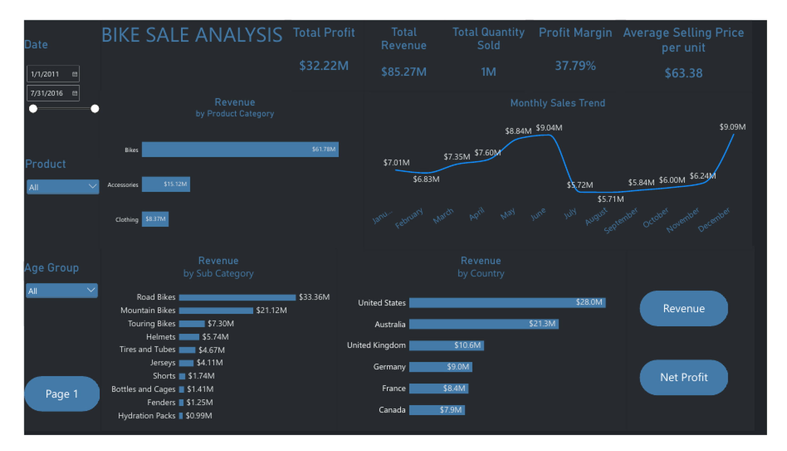
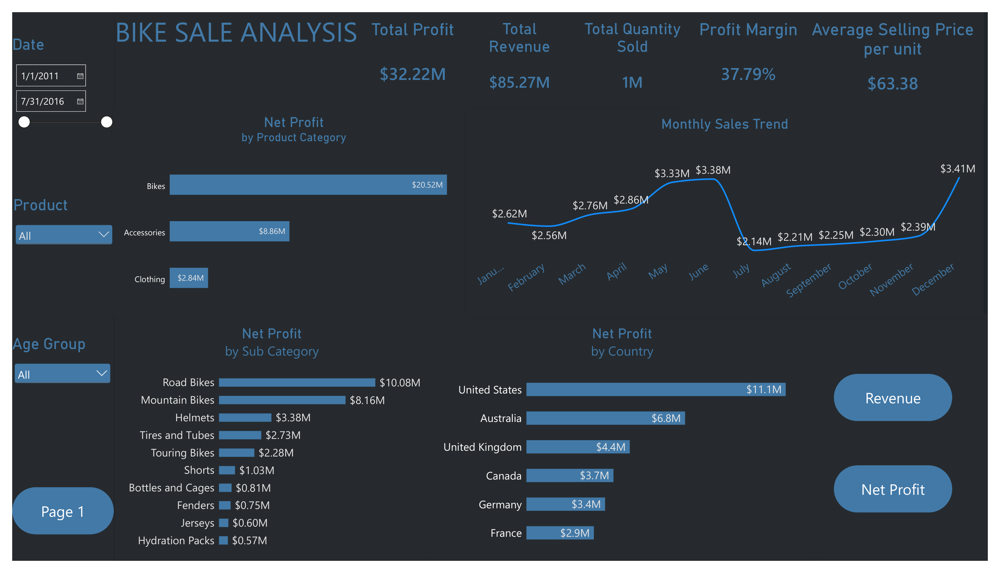
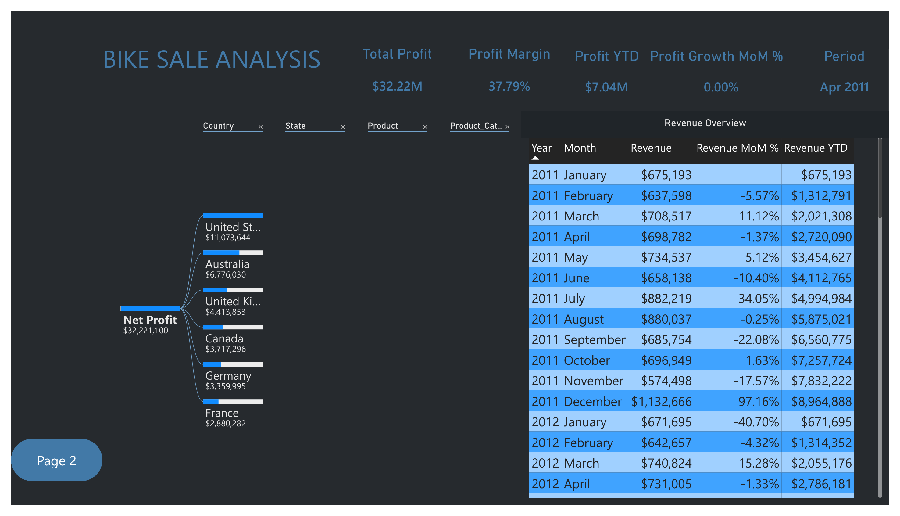
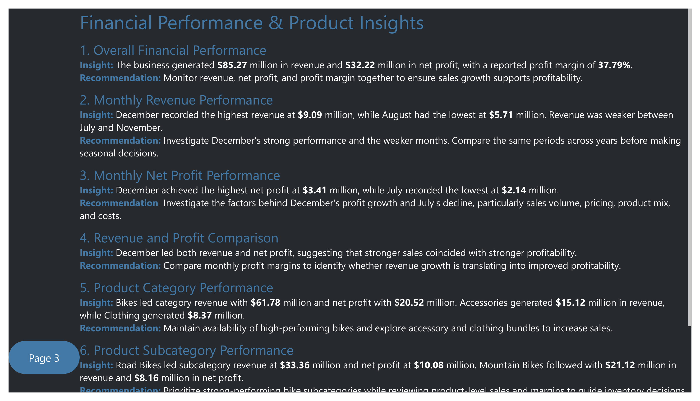
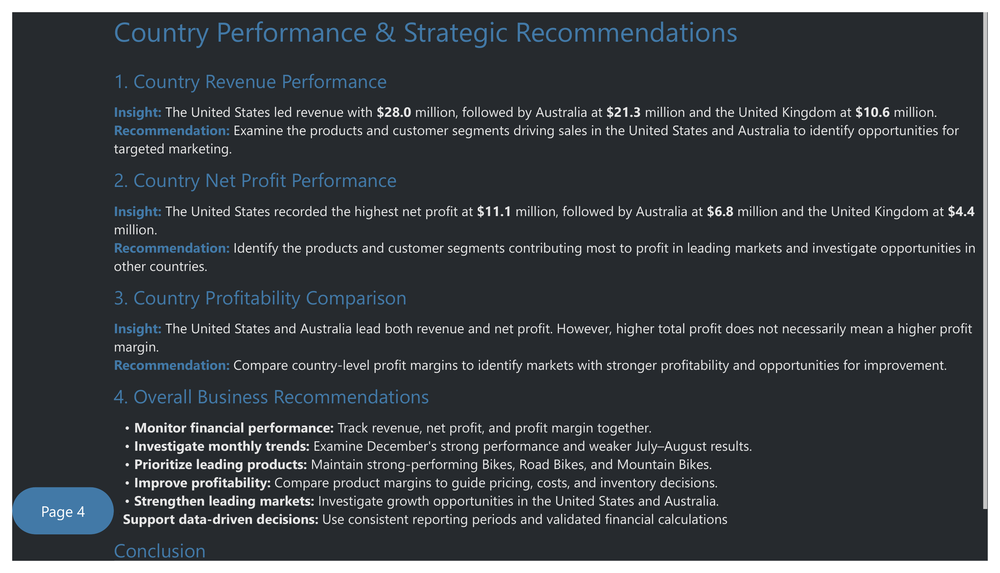

# Europe Bike Sales Analysis | Excel & Power BI
##  Project Overview

This project analyses bike sales data to evaluate financial performance, product performance, and geographical sales distribution.

Microsoft Excel was used for data cleaning and preparation, while Power BI was used to develop an interactive dashboard, calculate key performance indicators, and generate business insights.

The objective was to transform raw sales data into meaningful information that supports business decision-making and identifies opportunities for improving revenue and profitability.

##  Dataset Source

The dataset used for this project was obtained from Kaggle.

- **Dataset Name:** Europe Bike Store Sales
- **Source:** Kaggle
- **Dataset Provider:** PrepInsta Prime
- **Dataset Link:** [Europe Bike Store Sales – Kaggle](https://www.kaggle.com/datasets/prepinstaprime/europe-bike-store-sales)

The dataset contains bike sales transaction records, including customer demographics, product details, order quantities, revenue, cost, and profit. It was used to analyse financial performance, product performance, customer trends, and geographical sales distribution.

##  Project Objectives

- Evaluate overall revenue and net profit performance.
- Analyse monthly revenue and profit trends.
- Identify high-performing product categories and subcategories.
- Compare sales and profitability across countries.
- Monitor key financial performance indicators.
- Develop actionable business recommendations.

## Project Documentation

For a detailed explanation of the project, including data preparation, financial analysis, product performance, geographical analysis, and business recommendations, see the [Project Documentation](Documentation/Project_Documentation.md).

##  Tools and Technologies

| Tool | Application |
|---|---|
| Microsoft Excel | Data cleaning and preparation |
| Microsoft Power BI | Data analysis and visualization |
| DAX | KPI calculations and time-based analysis |

## Project Files

| File | Description |
|---|---|
| [Excel Workbook](Excel/Bike_Sale_2.xlsx) | Cleaned dataset and Excel data preparation. |
| [Power BI Dashboard](PowerBI/BIKE%20SALE%20ANALYSIS%20FINAL%20VISUALIZATION.pbix) | Interactive dashboard for revenue, net profit, product, and geographical analysis. |
| [Dashboard Screenshots](Screenshots/) | Images of the completed Power BI dashboard. |
| [Project Documentation](Documentation/Project_Documentation.md) | Detailed project process, analysis, findings, and recommendations.

##  Data Preparation

Data preparation was performed using Microsoft Excel.

Activities included:
- Reviewing the dataset for missing values.
- Handling incomplete customer information.
- Checking data consistency.
- Rearranging columns for better organization.
- Preparing the dataset for Power BI analysis.

##  Key Performance Indicators

The dashboard presents the following overall performance metrics:

| KPI | Result |
|---|---:|
| Total Revenue | $85.27M |
| Total Net Profit | $32.22M |
| Total Quantity Sold | 1M |
| Profit Margin | 37.79% |
| Average Selling Price | $63.38 |

##  Dashboard Features

The Power BI report contains four pages:

**Page 1: Net Profit and Revenue Overview**
- Interactive Revenue and Net Profit toggle.
- Financial KPI cards.
- Monthly performance trends.
- Product category and subcategory analysis.
- Country performance.
- Product and age group filters.

**Page 2: Revenue and Financial Performance**
- Total Profit.
- Profit Margin.
- Profit YTD.
- Profit Growth MoM %.
- Dynamic reporting period.
- Revenue overview table.
- Revenue MoM % and Revenue YTD.

**Page 3: Business Insights and Recommendations 1**
- Overall financial performance.
- Monthly revenue performance.
- Monthly net profit performance.
- Revenue and profit comparison.
- Product category performance.
- Product subcategory performance.

**Page 4: Business Insights and Recommendations 2**
- Country revenue performance.
- Country net profit performance.
- Country profitability comparison.
- Overall business recommendations.
- Project conclusion.

##  Key Business Insights

### Financial Performance
The business generated $85.27 million in revenue and $32.22 million in net profit, achieving a profit margin of 37.79%.

### Monthly Performance
December recorded the highest monthly revenue at $9.09 million, while August recorded the lowest at $5.71 million.

December also recorded the highest net profit at $3.41 million, while July recorded the lowest at $2.14 million.

### Product Performance
Bikes led product categories with $61.78 million in revenue and $20.52 million in net profit.

Road Bikes led the subcategories, generating $33.36 million in revenue and $10.08 million in net profit.

### Country Performance
The United States led country revenue with $28.0 million, followed by Australia at $21.3 million and the United Kingdom at $10.6 million.

The United States also recorded the highest net profit at $11.1 million.

##  Business Recommendations

- Monitor revenue, net profit, and profit margin together to evaluate financial performance.
- Investigate December's strong performance and weaker monthly periods.
- Maintain the availability of high-performing products, particularly Bikes, Road Bikes, and Mountain Bikes.
- Explore accessory and clothing bundles to increase sales.
- Analyse product-level profitability to guide pricing and inventory decisions.
- Investigate opportunities to strengthen performance in leading markets, particularly the United States and Australia.

##  Conclusion

The bike sales analysis revealed strong overall financial performance, generating $85.27 million in revenue and $32.22 million in net profit, with a profit margin of 37.79%.

Bikes emerged as the leading product category, while Road Bikes and Mountain Bikes were the strongest-performing subcategories in terms of revenue and net profit. December recorded the highest monthly revenue and net profit.

The United States and Australia were the leading markets in both revenue and net profit.

Overall, this project demonstrates how Excel and Power BI can transform sales data into meaningful business insights, helping identify growth opportunities, evaluate profitability, and support data-driven decision-making.

##  Dashboard Screenshots

### 1. Revenue Performance

### 2. Net Profit Performance

### 3. Net Profit and Revenue Overview

### 4. Financial Insights

### 5. Business Recommendations

##  Project Deliverables

- Excel dataset preparation.
- Interactive Power BI dashboard.
- Financial performance analysis.
- Business insights and recommendations.
- Project documentation.

---

**Tools:** Microsoft Excel | Microsoft Power BI | DAX

